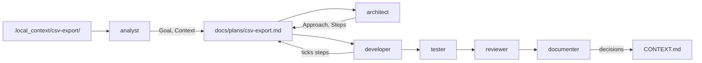

# agentic-defaults

Sensible defaults for agentic coding: test-first, reasonable coverage, and context that stays current.

Generic instructions, skills and agents for AI coding assistants, built around practical delivery and modest model budgets. Everything in [`kit/`](kit/) works in both **Claude Code** and **GitHub Copilot** (VS Code). Copy what you need into a project or your user folder.

## Quick start

1. **Copy** the contents of `kit/` into your project's root, or run `bash scripts/sync.sh <project-dir> --apply` from a clone of this repo.
2. **Scan** the project: ask your assistant to "use the analyst to scan this project". It writes the root `CONTEXT.md` and fills in the build and test commands in `AGENTS.md`. Review both.
3. **Work.** For small changes, just chat; the working agreement applies. For bigger ones, put your notes in `.local_context/<task>/` and follow [How work flows](#how-work-flows).

## How it's organized

- **Instructions** are loaded into every conversation, so they stay short. They hold the working agreement.
- **Skills** are practices, such as TDD, debugging, diagrams and project scans. They load only when a task needs them, so they can go into detail.
- **Agents** are roles: who does the work. Pick one from Copilot's agent dropdown, or let Claude Code delegate to it.
- **Working files** carry knowledge between sessions and agents: `CONTEXT.md` files describe the system, plan files describe a task, and `.local_context/` holds your private notes.

## What's inside

### Instructions and working files

| Path | What it does |
|---|---|
| [`kit/AGENTS.md`](kit/AGENTS.md) | The working agreement: deliver small, test first, start from written context, work economically, definition of done. |
| [`kit/CLAUDE.md`](kit/CLAUDE.md) | One line that makes Claude Code load `AGENTS.md`. |
| [`kit/.local_context/`](kit/.local_context/README.md) | A folder for private task notes (tickets, meeting notes, logs). It ignores itself in git, so nothing in it is committed. |

### Skills

| Skill | Use it for |
|---|---|
| [`project-scan`](kit/.claude/skills/project-scan/SKILL.md) | Learning an unfamiliar project and recording it in the root `CONTEXT.md` and `AGENTS.md`. Includes a read-only survey script. |
| [`task-plans`](kit/.claude/skills/task-plans/SKILL.md) | Turning notes into a plan file that carries a task from discovery to done and lets agents hand work over. |
| [`diagrams`](kit/.claude/skills/diagrams/SKILL.md) | Mermaid diagrams for architecture, flows, data models and state. |
| [`context-md`](kit/.claude/skills/context-md/SKILL.md) | What a `CONTEXT.md` contains, when to update it, and how to add one to an existing project. Includes a template and a check script that lists `CONTEXT.md` files a change may have made stale. |
| [`tdd`](kit/.claude/skills/tdd/SKILL.md) | The test-first loop, how much to test, refactoring safely. |
| [`debugging`](kit/.claude/skills/debugging/SKILL.md) | Finding the root cause before fixing, with a rule for when to stop guessing. |
| [`commits-and-prs`](kit/.claude/skills/commits-and-prs/SKILL.md) | Splitting work into commits, writing messages, and preparing and describing pull requests. Includes git safety rules for agents. |
| [`implementation`](kit/.claude/skills/implementation/SKILL.md) | The shared working rules of all developer agents: deliver fully, handle unplanned problems, dependencies, when to stop, what to report. |
| [`flask`](kit/.claude/skills/flask/SKILL.md) | Python and Flask: app factory, validation, record-level access checks, SQLAlchemy sessions and N+1, background work, pytest. |
| [`spring`](kit/.claude/skills/spring/SKILL.md) | Java and Spring Boot: DTOs, Bean Validation, Spring Security, `@Transactional` pitfalls, JPA fetching, MockMvc and Testcontainers. |
| [`react`](kit/.claude/skills/react/SKILL.md) | React: reuse what exists, all four data states, state and effects, forms, accessibility, security, React Testing Library. |
| [`relational-database`](kit/.claude/skills/relational-database/SKILL.md) | PostgreSQL, MySQL, SQLite: expand-then-contract migrations, Alembic, Flyway and Liquibase traps, engine-specific locking, strict stop rules. |

### Agents

| Role | Does | Edits | Model tier |
|---|---|---|---|
| [`analyst`](kit/.claude/agents/analyst.md) | Scans the project, and turns task notes into the discovery part of a plan. | Docs and plans | Everyday |
| [`architect`](kit/.claude/agents/architect.md) | Designs the approach and writes steps, diagrams and decisions into the plan. | Plans and design docs | Strong |
| [`relational-database-developer`](kit/.claude/agents/relational-database-developer.md) | Schema changes, migrations, indexes, queries and data fixes, with strict stop rules for anything irreversible. | Migrations, queries, tests | Everyday |
| [`flask-developer`](kit/.claude/agents/flask-developer.md) | Python Flask endpoints, services, jobs and integrations. | Server code, tests, docs | Everyday |
| [`spring-developer`](kit/.claude/agents/spring-developer.md) | Java Spring Boot controllers, services, repositories and configuration. | Server code, tests, docs | Everyday |
| [`react-developer`](kit/.claude/agents/react-developer.md) | React pages, components, hooks, forms and API calls. | UI code, tests, docs | Everyday |
| [`developer`](kit/.claude/agents/developer.md) | Anything no framework developer covers: scripts, tools, libraries, infrastructure, other stacks. | Code, tests, docs | Everyday |
| [`tester`](kit/.claude/agents/tester.md) | Finds untested behavior that matters, writes the tests, reports bugs. | Tests only | Everyday |
| [`reviewer`](kit/.claude/agents/reviewer.md) | Checks that a plan's goal was actually met, and reviews a change for bugs, missing tests, stale docs and over-engineering. | Nothing | Strong |
| [`security-reviewer`](kit/.claude/agents/security-reviewer.md) | Reviews a change for exploitable security problems, reporting only those with a plausible attack path. | Nothing | Strong |
| [`documenter`](kit/.claude/agents/documenter.md) | Keeps `CONTEXT.md` and docs true to the code, and closes finished plans. | Docs only | Everyday |

## How work flows

**Once per project**, have the analyst scan it. That produces the root `CONTEXT.md` (purpose, stack, structure, a diagram) and the build and test commands in `AGENTS.md`. Every later task starts from there.

**Per task**, put your notes in `.local_context/<task>/` and go through the roles, skipping any the task doesn't need:



1. **Analyst** reads your notes and the code, and writes the plan's Goal, Context, Requirements and Open questions.
2. **Architect** answers the open questions, designs the approach and writes the Steps.
3. **Developers** implement one or a few steps at a time. Each step names its agent, and the architect orders steps database, then backend, then frontend: "relational-database-developer: implement step 1 of `docs/plans/csv-export.md`." All developers share the `implementation` skill's rules; each framework developer adds its framework's skill.
4. **Tester** fills the gaps in coverage.
5. **Reviewer** checks the result against the plan. Add the **security reviewer** when the change touches authentication, permissions, untrusted input, secrets, cryptography or dependencies; the reviewer tells you when.
6. **Documenter** moves the plan's decisions into `CONTEXT.md` and closes the plan.

Small changes need none of this: the working agreement and skills cover a normal chat. Roles don't call each other. Each one hands its result back to you, or to the main conversation, which keeps cost predictable.

## Keeping model costs down

- **Cheap models read, strong models think.** The analyst (everyday model) digests the notes and code; the architect (strong model) reads only its short summary.
- **Think once, execute many times.** The architect writes steps concrete enough for an everyday model to carry out one at a time.
- **The plan file is the handoff.** Agents get a path and step numbers instead of a pasted plan, and a fresh session picks up where the last one stopped.
- **Prompts are written for everyday models**: numbered steps, an explicit output format, and clear points where the agent stops and reports instead of trying again.
- **The survey script does the mechanical part** of a project scan in one command, instead of dozens of searches.

**Model tiers.** "Strong" means your best reasoning model; "everyday" means a fast, inexpensive one.

- **Claude Code** reads each agent's `model` field: `sonnet` for strong roles and `haiku` for everyday ones. Change it to suit you; `inherit` uses the conversation's model.
- **Copilot (VS Code)** doesn't read `model` from `.claude/agents` files, so an agent uses whichever model is selected in the chat. Use your everyday model by default and switch to a strong one for the architect and reviewers. To pin a model, copy the agent to `.github/agents/<name>.agent.md` and set `model` to a name from Copilot's model picker.

## Where to copy

| Kind | Claude Code | GitHub Copilot (VS Code) |
|---|---|---|
| Instructions, per project | `AGENTS.md` and `CLAUDE.md` at the project root | `AGENTS.md` at the project root, or merge its content into `.github/copilot-instructions.md` |
| Instructions, personal | Import from `~/.claude/CLAUDE.md`, e.g. `@path/to/AGENTS.md` | `~/.copilot/copilot-instructions.md` |
| Skills, per project | `.claude/skills/<name>/` | `.claude/skills/<name>/` or `.github/skills/<name>/` |
| Skills, personal | `~/.claude/skills/<name>/` | `~/.copilot/skills/<name>/` |
| Agents, per project | `.claude/agents/<name>.md` | `.claude/agents/<name>.md`, or `.github/agents/<name>.agent.md` |
| Agents, personal | `~/.claude/agents/<name>.md` | `~/.claude/agents/<name>.md` or `~/.copilot/agents/<name>.agent.md` |
| Local notes | `.local_context/` at the project root | Same |

Copying the whole `kit/` folder into a project root gives both tools everything. Copy each skill as a whole folder, since it may contain a template or script. Agents refer to skills by name, so copy the skills an agent lists along with it.

Keep only the framework pairs your project uses: a Flask and React project deletes `spring-developer.md` and `skills/spring/`. Fewer agents mean a shorter agent list in Copilot and less guessing when Claude Code picks one. To update later without bringing deleted pairs back, run sync with `--apply --existing-only`.

After copying, run a project scan to fill in the **This project** section of `AGENTS.md`, or fill it in by hand.

### Projects that already have AI files

- **`CLAUDE.md` or `.github/copilot-instructions.md` with content**: move the project-specific parts (commands, done checks, conventions) into the **This project** section of `AGENTS.md`, then replace `CLAUDE.md` with the one-line import. Both tools then read the same rules.
- **An existing `CONTEXT.md` or architecture notes**: the project scan keeps their stable facts, splits them by area and drops volatile parts such as test counts and issue lists.
- **Decision records** such as `docs/adr/`: the kit uses them instead of repeating decisions in `CONTEXT.md`.
- **Folders of private notes** such as exported specs: move them into `.local_context/` so they can't be committed by accident.

## Updating a project's copy

Hand-copied files fall behind as the kit improves. From a clone of this repo:

```bash
bash scripts/sync.sh ~/path/to/project
```

It lists which kit files are missing, differ or are the same in the project. Add `--diff` to see the changes, and `--apply` to update. `--apply` replaces only the part of `AGENTS.md` above **This project**, never overwrites a `CLAUDE.md` that has its own content, and leaves files that aren't part of the kit alone. It does overwrite local tweaks to kit files, such as a changed model, so review the result with `git diff`. The first line of a project's `AGENTS.md` shows which kit version it came from, and [CHANGELOG.md](CHANGELOG.md) lists what changed since.

## Keeping CONTEXT.md current

Agents are told to update `CONTEXT.md` as part of every change, and the reviewer checks for it. Instructions alone still slip, so the `context-md` skill ships a check script. It lists every `CONTEXT.md` whose area has code changes while the file itself didn't change:

```bash
bash .claude/skills/context-md/check.sh
```

The developer, reviewer and documenter run it themselves. You can also run it automatically:

- **Before each commit**, as a reminder that doesn't block. Save this as `.git/hooks/pre-commit` and make it executable:

  ```bash
  #!/usr/bin/env bash
  bash .claude/skills/context-md/check.sh || true
  ```

- **On pull requests**, in GitHub Actions. Check out with `fetch-depth: 0`, then add a step that runs `bash .claude/skills/context-md/check.sh --base origin/${{ github.base_ref }}`. Add `--strict` to fail the build when there is something to check.

The script flags candidates; it can't tell whether an update is needed. Internal refactors and bug fixes that restore documented behavior need none.

## Recommended tools

The skills use these when they're installed and fall back to git and plain searches when they're not. On macOS:

```bash
brew install ripgrep fd tree ast-grep jq yq scc
```

The Mermaid CLI lets agents check that a diagram renders:

```bash
npm install -g @mermaid-js/mermaid-cli
```

## Customizing

- **Restrictions are instructions, not enforcement.** "Edits tests only" is written in the agent's text. To enforce it, add a `tools` list to the agent, for example `tools: Read, Grep, Glob, Bash` for a read-only reviewer. Claude Code uses these names directly, and VS Code maps them for files in `.claude/agents`. Check that the agent can still do its job afterwards.
- **`skills` in an agent's frontmatter** preloads those skills in Claude Code. Copilot ignores the field and loads skills when they're relevant.
- **Plans folder and retention** are set in the "This project" section of `AGENTS.md`.
- **Another framework** (FastAPI, Django, Angular, Vue and so on) is a pair: a `<framework>` skill and a `<framework>-developer` agent. Copy the closest existing pair, keep the skill's sections (follow the project first, structure, the framework's own concerns, tests, stop and report before), and keep `implementation` in the agent's `skills` list so it follows the shared rules. Project-specific conventions go in the area's `CONTEXT.md`, not in the skill.

## Working on this repo

Rules for maintainers and AI assistants are in [AGENTS.md](AGENTS.md). Before committing, run:

```bash
python3 scripts/check.py
```

```bash
python3 -m unittest discover -s tests
```

`check.py` verifies frontmatter, skill references, links, this README's tables, version markers, the word budget of the working agreement, script syntax and, when the Mermaid CLI is installed, that diagrams render. The tests cover the scripts' behavior. CI runs both on Linux and macOS.

## Credits

Several delivery safeguards are adapted from [GSD Core](https://github.com/open-gsd/gsd-core) (MIT): goal checks in review, the developer's rules for unplanned work, the ban on watered-down requirements, and dependency safety. GSD is a much larger framework with its own installer and phase loop; this kit takes a few of its ideas in a lighter, copy-by-hand form.

## License

[MIT](LICENSE) © Sasa Zejnilovic
