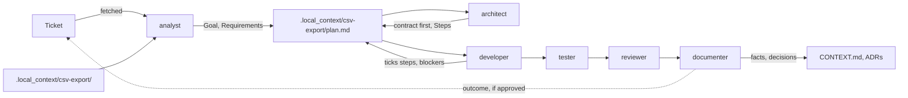

# agentic-defaults

Sensible defaults for agentic coding: test-first, reasonable coverage, and context that stays current.

Generic instructions, skills and agents for AI coding assistants, built around practical delivery and modest model budgets. Everything in [`kit/`](kit/) works in both **Claude Code** and **GitHub Copilot** (VS Code). Other tools that read `AGENTS.md`, such as Cursor, get the working agreement; the skills and agents have only been tested in Claude Code and Copilot. Install it in a project with [agd](https://github.com/Zejnilovic/agd), or copy what you need.

**Why it works this way:** [Working with coding agents](https://zejnilovic.eu/guides/working-with-coding-agents) explains the method behind the kit ([same text in this repo](docs/methodology.md)). It covers the principles, rules of thumb, anti-patterns and nine hands-on exercises, and is written to stay true as tools and models change.

## Quick start

1. **Install** [agd](https://zejnilovic.github.io/agd), with Homebrew:

   ```bash
   brew install zejnilovic/tap/agd
   ```

   Or without Homebrew:

   ```bash
   curl -fsSL https://raw.githubusercontent.com/Zejnilovic/agd/main/install.sh | bash
   ```

2. **Add the kit** in your project's root, then commit the new files together with `.agd.lock`:

   ```bash
   agd init
   ```

   That installs every [pack](#packs). To install only some, name them, for example `agd init --with flask,react`; the packs they require come along. Add `copilot-hook` to the list if you use Copilot. Without agd, copy the contents of `kit/` into the project's root.
3. **Scan** the project: ask your assistant to "use the analyst to scan this project". It writes the root `CONTEXT.md`, proposes a [project profile](#project-profile), fills in the [standard commands](#standard-commands) in `AGENTS.md`, and proposes any that are missing. Review and confirm them.
4. **Work.** For small changes, just chat; the working agreement applies. For bigger ones, give it the ticket number or put your notes in `.local_context/<task>/`, and follow [How work flows](#how-work-flows).

## How it's organized

- **Instructions** are loaded into every conversation, so they stay short. They hold the working agreement.
- **Skills** are practices, such as TDD, debugging, diagrams and project scans. They load only when a task needs them, so they can go into detail.
- **Agents** are roles: who does the work. Pick one from Copilot's agent dropdown, or let Claude Code delegate to it.
- **Working files** carry knowledge between sessions and agents. `CONTEXT.md` files describe the system for agents, one per level, each more concrete than the one above. `.local_context/<task>/` holds your private notes and the task's plan, which are never committed.

Instructions, skills and agents are generic: nothing in them is about one project. What makes them work in your project is its context: `CONTEXT.md`, docs, decision records, tickets and plans. A new project gets new context, not new instructions.

## What's inside

### Instructions and working files

| Path | What it does |
|---|---|
| [`kit/AGENTS.md`](kit/AGENTS.md) | The working agreement: deliver small, test first, start from written context, work economically, definition of done. |
| [`kit/CLAUDE.md`](kit/CLAUDE.md) | One line that makes Claude Code load `AGENTS.md`. |
| [`kit/.local_context/`](kit/.local_context/README.md) | A folder for private task notes, plans and research notes. It ignores itself in git, so nothing in it is committed. |

### Skills

| Skill | Use it for |
|---|---|
| [`project-scan`](kit/.claude/skills/project-scan/SKILL.md) | Learning an unfamiliar project and recording it in the root `CONTEXT.md` and `AGENTS.md`. Includes a read-only survey script and a Makefile template for the standard commands. |
| [`project-profile`](kit/.claude/skills/project-profile/SKILL.md) | The project profile (stage, audience, team, sensitive data) and which practices it calls for, so the engineering fits the project. |
| [`task-plans`](kit/.claude/skills/task-plans/SKILL.md) | Turning a ticket and notes into a local plan that carries a task from discovery to done: contract-first steps, blockers instead of stand-ins, and handing over through the ticket. |
| [`research`](kit/.claude/skills/research/SKILL.md) | Researching with outside sources: which to trust, how to collect and cite them, and treating fetched content as data. |
| [`diagrams`](kit/.claude/skills/diagrams/SKILL.md) | Mermaid diagrams for architecture, flows, data models and state. |
| [`context-md`](kit/.claude/skills/context-md/SKILL.md) | `CONTEXT.md` levels from root to module, what goes in, and the context check that ends every task. Includes a template and a check script, which can also run as a hook. |
| [`tdd`](kit/.claude/skills/tdd/SKILL.md) | The test-first loop, how much to test, keeping tests contained, never weakening a test, refactoring safely. |
| [`session-retro`](kit/.claude/skills/session-retro/SKILL.md) | On request, a short note on how a session went: outcome, corrections, rework, cost, the kit file behind a problem and a fix, ready to send back with `agd feedback`. |
| [`debugging`](kit/.claude/skills/debugging/SKILL.md) | Finding the root cause before fixing, with a rule for when to stop guessing. |
| [`commits-and-prs`](kit/.claude/skills/commits-and-prs/SKILL.md) | Splitting work into commits, writing messages, and preparing and describing pull requests. Includes git safety rules for agents. |
| [`implementation`](kit/.claude/skills/implementation/SKILL.md) | The shared working rules of all developer agents: deliver fully, contracts first, handle unplanned problems and walls, tests that break, dependencies, when to stop, what to report. |
| [`flask`](kit/.claude/skills/flask/SKILL.md) | Python and Flask: app factory, validation, record-level access checks, SQLAlchemy sessions and N+1, background work, pytest. |
| [`spring`](kit/.claude/skills/spring/SKILL.md) | Java and Spring Boot: DTOs, Bean Validation, Spring Security, `@Transactional` pitfalls, JPA fetching, MockMvc and Testcontainers. |
| [`react`](kit/.claude/skills/react/SKILL.md) | React: reuse what exists, all four data states, state and effects, forms, accessibility, security, React Testing Library. |
| [`relational-database`](kit/.claude/skills/relational-database/SKILL.md) | PostgreSQL, MySQL, SQLite: expand-then-contract migrations, Alembic, Flyway and Liquibase traps, engine-specific locking, strict stop rules. |

### Agents

| Role | Does | Edits | Model tier |
|---|---|---|---|
| [`analyst`](kit/.claude/agents/analyst.md) | Scans the project, and turns a ticket and notes into the discovery part of a plan. | Docs and plans | Everyday |
| [`research-collector`](kit/.claude/agents/research-collector.md) | Gathers sources on a question into notes, for the researcher or a person. Doesn't judge. | Research notes | Everyday |
| [`researcher`](kit/.claude/agents/researcher.md) | Answers a question that needs outside knowledge: options, a recommendation, confidence and sources. | Research notes | Strong |
| [`architect`](kit/.claude/agents/architect.md) | Designs the approach, contract first, writes steps, diagrams and decisions into the plan, and decides blockers. | Plans and design docs | Strong |
| [`relational-database-developer`](kit/.claude/agents/relational-database-developer.md) | Schema changes, migrations, indexes, queries and data fixes, with strict stop rules for anything irreversible. | Migrations, queries, tests | Everyday |
| [`flask-developer`](kit/.claude/agents/flask-developer.md) | Python Flask endpoints, services, jobs and integrations. | Server code, tests, docs | Everyday |
| [`spring-developer`](kit/.claude/agents/spring-developer.md) | Java Spring Boot controllers, services, repositories and configuration. | Server code, tests, docs | Everyday |
| [`react-developer`](kit/.claude/agents/react-developer.md) | React pages, components, hooks, forms and API calls. | UI code, tests, docs | Everyday |
| [`developer`](kit/.claude/agents/developer.md) | Anything no framework developer covers: scripts, tools, libraries, infrastructure, other stacks. | Code, tests, docs | Everyday |
| [`tester`](kit/.claude/agents/tester.md) | Finds untested behavior that matters, writes the tests, reports bugs. | Tests only | Everyday |
| [`reviewer`](kit/.claude/agents/reviewer.md) | Checks that a plan's goal was actually met, and reviews a change for bugs, broken contracts, weakened tests, stand-ins, stale docs and over-engineering. | Nothing | Strong |
| [`security-reviewer`](kit/.claude/agents/security-reviewer.md) | Reviews a change for exploitable security problems, reporting only those with a plausible attack path. | Nothing | Strong |
| [`documenter`](kit/.claude/agents/documenter.md) | Keeps `CONTEXT.md` and docs true to the code, closes finished plans, and drafts ticket updates for handover. | Docs only | Everyday |

## How work flows

**Once per project**, have the analyst scan it. That produces the root `CONTEXT.md` (purpose, stack, structure, contracts, a diagram) and the standard commands in `AGENTS.md`. Every later task starts from there.

**Per task**, give the ticket number or put your notes in `.local_context/<task>/`, and go through the roles, skipping any the task doesn't need:



1. **Analyst** fetches the ticket, reads your notes and the code, and writes the plan's Goal, Context, Requirements and Open questions.
2. **Researcher**, only when the design depends on outside facts such as a library choice or an API. The **research collector** can gather the sources first, on an everyday model.
3. **Architect** answers the open questions, designs the approach and writes the Steps. When the work crosses a boundary, step 1 changes only the contract.
4. **Developers** implement one or a few steps at a time, each finished with the context check. Each step names its agent, in the order contract, database, backend, frontend: "relational-database-developer: implement step 2 of `.local_context/csv-export/plan.md`." All developers share the `implementation` skill's rules, and each framework developer adds its framework's skill. When a step hits a wall, the developer records it as a blocker and stops, and the architect or you decide how to continue.
5. **Tester** fills the gaps in coverage.
6. **Reviewer** checks the result against the plan. Add the **security reviewer** when the change touches authentication, permissions, untrusted input, secrets, cryptography or dependencies; the reviewer tells you when.
7. **Documenter** moves what lasts into `CONTEXT.md` and decision records, drafts an outcome for the ticket, and deletes the plan.

To hand a task to someone else mid-way, ask the documenter to draft a ticket update from the plan.

Small changes need none of this: the working agreement and skills cover a normal chat. Roles don't call each other. Each one hands its result back to you, or to the main conversation, which keeps cost predictable.

## Keeping model costs down

- **Cheap models read, strong models think.** The analyst and the research collector (everyday model) digest notes, code and sources; the architect and the researcher (strong model) read only their short summaries.
- **Orchestration is cheap.** The main conversation only routes steps to agents and collects their reports, so it can run on an everyday model. It passes blockers and design questions on to you or the architect instead of answering them.
- **Short output.** Agents report the result first, one line per item, so their reports don't bloat the conversation that reads them.
- **Think once, execute many times.** The architect writes steps concrete enough for an everyday model to carry out one at a time.
- **The plan file is the handoff.** Agents get a path and step numbers instead of a pasted plan, and a fresh session picks up where the last one stopped.
- **Prompts are written for everyday models**: numbered steps, an explicit output format, and clear points where the agent stops and reports instead of trying again.
- **The survey script does the mechanical part** of a project scan in one command, instead of dozens of searches.

**Model tiers.** "Strong" means your best reasoning model; "everyday" means a fast, inexpensive one.

- **Claude Code** reads each agent's `model` field: `sonnet` for strong roles and `haiku` for everyday ones. Change it to suit you; `inherit` uses the conversation's model.
- **Copilot (VS Code)** doesn't read `model` from `.claude/agents` files, so an agent uses whichever model is selected in the chat. Use your everyday model by default and switch to a strong one for the architect and reviewers. To pin a model, copy the agent to `.github/agents/<name>.agent.md` and set `model` to a name from Copilot's model picker.

## Claude Code and GitHub Copilot

The kit is plain Markdown, shell scripts and JSON in the formats both tools read. Where they differ:

| | Claude Code | GitHub Copilot (VS Code) |
|---|---|---|
| Working agreement | `CLAUDE.md` imports `AGENTS.md` | Reads `AGENTS.md` directly |
| Skills | Loaded when relevant; an agent's `skills:` list preloads them | Reads `.claude/skills/` and loads them when relevant; ignores `skills:`, so each agent also names its skills and keeps a short fallback |
| Agents | Subagents, chosen by their description or by name | Modes in the agent dropdown, or subagents once **Run Subagent** is enabled under Configure Tools |
| Model per agent | The agent's `model:` field | The model selected in the chat, or `model` in a `.github/agents/<name>.agent.md` copy |
| Scripts, `make`, `gh` | Run in the terminal | The same; agent mode runs terminal commands |
| End-of-turn context check | A `Stop` hook you add to `.claude/settings.json` | `.github/hooks/context-check.json`, shipped with the kit |
| Web research | Built-in web search and page fetching | The fetch tool for pages; without web access, the research agents fall back to local sources and say so |

Copilot support follows the VS Code and GitHub documentation. Everything except the Copilot hook has been used in a project; check the hook in your first Copilot session.

## Where the files go

| Kind | Claude Code | GitHub Copilot (VS Code) |
|---|---|---|
| Instructions, per project | `AGENTS.md` and `CLAUDE.md` at the project root | `AGENTS.md` at the project root, or merge its content into `.github/copilot-instructions.md` |
| Instructions, personal | Import from `~/.claude/CLAUDE.md`, e.g. `@path/to/AGENTS.md` | `~/.copilot/copilot-instructions.md` |
| Skills, per project | `.claude/skills/<name>/` | `.claude/skills/<name>/` or `.github/skills/<name>/` |
| Skills, personal | `~/.claude/skills/<name>/` | `~/.copilot/skills/<name>/` |
| Agents, per project | `.claude/agents/<name>.md` | `.claude/agents/<name>.md`, or `.github/agents/<name>.agent.md` |
| Agents, personal | `~/.claude/agents/<name>.md` | `~/.claude/agents/<name>.md` or `~/.copilot/agents/<name>.agent.md` |
| Local notes | `.local_context/` at the project root | Same |
| End-of-turn context check | A Stop hook you add to `.claude/settings.json` ([snippet](#keeping-contextmd-current)) | `.github/hooks/context-check.json`, shipped with the kit |

agd installs into the per-project paths, which give both tools everything. It doesn't install into your home folder yet: copy personal files by hand. When copying, copy each skill as a whole folder, since it may contain a template or script, and copy the skills an agent lists along with it.

### Packs

agd installs the kit in packs, so a project gets only the frameworks it uses. Fewer agents mean a shorter agent list in Copilot and less guessing when Claude Code picks one.

| Pack | Contents | Requires |
|---|---|---|
| `core` | The working agreement, `.local_context/`, the analyst, architect, developer, tester, reviewer, security reviewer and documenter, the skills they use, and `session-retro` | |
| `research` | The research collector and the researcher, and the `research` skill | `core` |
| `flask`, `spring`, `react`, `relational-database` | Each framework's developer and skill | `core` |
| `copilot-hook` | The end-of-turn context check for Copilot | `core` |

`agd add spring` and `agd remove spring` change a project's packs later; removing keeps the files you changed. To keep single files out, list them in `.agd-ignore` at the project root, and commit it:

```text
# We have our own documenter
.claude/agents/documenter.md
```

After installing, run a project scan to fill in the **This project** section of `AGENTS.md`, or fill it in by hand.

### Projects that already have AI files

- **A copy of this kit made by hand or with the old `scripts/sync.sh`**: run `agd adopt` in the project. It reads the version from the first line of `AGENTS.md` and records the kit files in `.agd.lock` without changing any; `agd status` then shows what differs, and `agd update` brings the project up to date.
- **`CLAUDE.md` or `.github/copilot-instructions.md` with content**: move the project-specific parts (commands, done checks, conventions) into the **This project** section of `AGENTS.md`, then replace `CLAUDE.md` with the one-line import. Both tools then read the same rules.
- **An existing `CONTEXT.md` or architecture notes**: the project scan keeps their stable facts, splits them by area and drops volatile parts such as test counts and issue lists.
- **Decision records** such as `docs/adr/`: the kit uses them instead of repeating decisions in `CONTEXT.md`.
- **Folders of private notes** such as exported specs: move them into `.local_context/` so they can't be committed by accident.
- **A `docs/plans/` folder from kit 0.1.0**: move each active plan to `.local_context/<task>/plan.md`, move finished plans' decisions into decision records or `CONTEXT.md`, and delete the folder. Remove the "Plans" line from **This project**.

## Standard commands

Every project should offer the same commands, each wrapping the project's real tools. Then one instruction, "run `make test`", works everywhere, for agents and people alike:

| Command | Does |
|---|---|
| `make setup` | Install dependencies and prepare a local environment |
| `make run` | Start the application locally |
| `make build` | Build everything that ships |
| `make test` | Run all tests; `make test T=<path>` runs one file or test |
| `make lint` | Lint and type-check |
| `make format` | Format the code |
| `make check` | Everything that must pass before work is done |

The working agreement defines done as "`make check` passes". The project scan reports which commands are missing and proposes them, using [Makefile.template](kit/.claude/skills/project-scan/Makefile.template); it never adds them without asking. Make is on nearly every macOS and Linux machine. On Windows, use it through WSL, or install it with a package manager.

## Project profile

Not every project needs every practice. An internal tool for ten people shouldn't be built like a bank's payment system. Each project describes itself in the **Profile** part of "This project" in `AGENTS.md`. That section belongs to the project, and kit updates never change it:

```markdown
### Profile

- Stage: production
- Audience: internal
- Team: small
- Handles: money, personal data
```

| Dimension | Values | Decides |
|---|---|---|
| Stage | prototype, early, production, mature | How much engineering rigor: test depth, migration safety, compatibility |
| Audience | personal, internal, customer, public | Security depth, versioned API contracts, accessibility, abuse limits |
| Team | solo, small, several | Formality: decision records, contracts and contract tests between teams |
| Handles | none, or money, personal data, regulated data, safety | Risk at any size: security reviews, audit trails, backups before migrations |

Costly items in the skills carry a tag, such as `(production)`, `(external)`, `(public)`, `(teams)` or `(sensitive)`. A tagged item applies only when the profile matches. Cheap correctness and safety always apply: input validation, access checks, parameterized queries, tests, and stopping before data loss. The [`project-profile`](kit/.claude/skills/project-profile/SKILL.md) skill defines the tags, says what each value adds or relaxes, and lists the signs of building for a bigger project than this one. The project scan proposes a profile from what it finds, and you confirm it.

For example, an internal time-tracking tool in production, run by a small team, that handles billing and employee data, gets security reviews for billing and sign-in changes and migrations that keep live data safe. It doesn't get contract tests, Testcontainers or feature switches.

## Kit files and project files

Kit files are replaced when the kit updates. Each one says so at the top with a "From agentic-defaults" marker, and in `AGENTS.md` everything above "This project" belongs to the kit. Three parts of kit files belong to the project, and updates keep them: an agent's `model:` and `tools:` lines, and a `## This project` section at the end of an agent or skill. Agents are told never to edit anything else in kit files, and never to tell you to. When you ask for something specific to your project, they put it here instead:

| You ask for | It goes in |
|---|---|
| A rule or command for this project | "This project" in `AGENTS.md`, which every agent reads |
| A different model for an agent | That agent's `model:` line |
| Limits on what an agent may use | A `tools:` line in that agent ([Customizing](#customizing)) |
| Extra instructions for one agent or skill | A `## This project` section at the end of that file |
| A fact or convention about part of the code | That area's `CONTEXT.md` |
| A project-only role or practice | A new agent or skill file with its own name; kit updates never touch it |
| Different behavior from a kit file | A copy under a new name, with the original listed in `.agd-ignore` |
| A change every project would benefit from | A suggestion for this repository |

## Updating a project

`agd status` shows what an update would do, and `agd update` does it:

```bash
agd status
```

```bash
agd update
```

- Kit files you haven't changed get the new version. Your `model:` and `tools:` lines and `## This project` sections stay.
- A kit file you changed anywhere else is left alone. `agd status` shows it as edited, and as having a newer version when the kit changed it too. `agd diff <path>` shows both sides, `agd merge <path>` merges the kit's changes into yours, and `agd reset <path>` takes the kit's version.
- Files that aren't the kit's are never touched.
- `agd update --to 0.4.0` moves to a given release, and `agd status --check` exits 1 when an update is due, for CI.

The [releases](https://github.com/Zejnilovic/agentic-defaults/releases) list what changed, with manual steps where a project needs them, and [CHANGELOG.md](CHANGELOG.md) has what's coming next. [agd's documentation](https://zejnilovic.github.io/agd) covers the rest of agd.

### Combining with your own

- **Your own agents and skills**: new files with their own names. agd never touches files it didn't install.
- **Your team's setup on top of this kit**: publish it as an agd source ([how](https://github.com/Zejnilovic/agd/blob/main/docs/sources.md)) and add it with `agd init your-org/your-setup`. Its packs can require this kit's, for example `requires agentic-defaults:core`.
- **Your team's version of a kit file**: when both ship the same path, agd stops and asks you to choose with a line in `.agd-ignore`: `agentic-defaults:<path>` uses your team's copy, and `<your-source>:<path>` keeps this kit's.

`.agd-ignore` replaces `.agentic-defaults-ignore` from before 0.4.0; agd still reads the old file.

## Keeping CONTEXT.md current

`CONTEXT.md` files are for agents, so agents keep them current: every task ends with a context check. Any single layer can slip, so the kit enforces it in several: the working agreement's definition of done, the developers' last step, the reviewer's checklist, and a check script in the `context-md` skill. The script lists every `CONTEXT.md` whose area has code changes while the file itself didn't change:

```bash
bash .claude/skills/context-md/check.sh
```

Agents run it themselves. You can also run it automatically:

- **At the end of each agent turn**, in both tools. When code changed and a `CONTEXT.md` didn't, the agent gets one reminder and either updates the file or says why none is needed. The same finding is never raised twice. The script's `--hook` mode prints `{"decision": "block", "reason": ...}`, which Claude Code's `Stop` hook and Copilot's `agentStop` hook both read as "keep working with this instruction".
  - **GitHub Copilot** (VS Code, CLI and cloud agent): the kit ships [`.github/hooks/context-check.json`](kit/.github/hooks/context-check.json), so it is on as soon as the kit is installed. Copilot hooks are in preview in VS Code, an organization can restrict them, and the cloud agent only reads hooks from the default branch. The file follows GitHub's documentation but hasn't been tested in a real Copilot session yet. To turn it off, run `agd remove copilot-hook`.
  - **Claude Code**: add a Stop hook to `.claude/settings.json` (shared with the team) or `.claude/settings.local.json` (just you), merged with what's already there. The kit doesn't ship this file, because updating it would overwrite a project's own settings.

  ```json
  {
    "hooks": {
      "Stop": [
        {
          "hooks": [
            { "type": "command", "command": "bash \"$CLAUDE_PROJECT_DIR/.claude/skills/context-md/check.sh\" --hook" }
          ]
        }
      ]
    }
  }
  ```

  Copilot in VS Code also reads `.claude/settings.json`. If both hooks are set up, the second call finds the same finding and stays silent.

- **Before each commit**, as a reminder that doesn't block. Save this as `.git/hooks/pre-commit` and make it executable:

  ```bash
  #!/usr/bin/env bash
  bash .claude/skills/context-md/check.sh || true
  ```

- **On pull requests**, in GitHub Actions. Check out with `fetch-depth: 0`, then add a step that runs `bash .claude/skills/context-md/check.sh --base origin/${{ github.base_ref }}`. Add `--strict` to fail the build when there is something to check.

The script flags candidates; it can't tell whether an update is needed. Internal refactors and bug fixes that restore documented behavior need none.

## Recommended tools

The skills use these when they're installed and fall back to git and plain searches when they're not. On macOS:

```bash
brew install ripgrep fd tree ast-grep jq yq scc
```

The Mermaid CLI lets agents check that a diagram renders:

```bash
npm install -g @mermaid-js/mermaid-cli
```

## Customizing

- **Restrictions are instructions, not enforcement.** "Edits tests only" is written in the agent's text. To enforce it, add a `tools` list to the agent, for example `tools: Read, Grep, Glob, Bash` for a read-only reviewer. Claude Code uses these names directly, and VS Code maps them for files in `.claude/agents`. Check that the agent can still do its job afterwards. Kit updates keep the line, as they keep `model:`.
- **`skills` in an agent's frontmatter** preloads those skills in Claude Code. Copilot ignores the field and loads skills when they're relevant.
- **Another framework** (FastAPI, Django, Angular, Vue and so on) is a pair: a `<framework>` skill and a `<framework>-developer` agent. Copy the closest existing pair, keep the skill's sections (follow the project first, structure, the framework's own concerns, tests, stop and report before), and keep `implementation` in the agent's `skills` list so it follows the shared rules. Project-specific conventions go in the area's `CONTEXT.md`, not in the skill.

## Feedback

It's early days. If something works well for you, breaks, or is missing, [open an issue](https://github.com/Zejnilovic/agentic-defaults/issues) or start a [discussion](https://github.com/Zejnilovic/agentic-defaults/discussions). Problems with installing or updating belong in [agd's issues](https://github.com/Zejnilovic/agd/issues).

**A kit file made an agent go wrong?** In a project installed with agd (0.2.0 or newer), report it from the project:

```bash
agd feedback
```

agd asks which kit files, what went wrong, what you expected and how the task ended. If you already have a note, for example one the agent wrote when you asked it to "retro this session" (the `session-retro` skill), pass it instead: `agd feedback .local_context/feedback/<note>.md`. Either way agd adds the kit version and whether you changed each file, and opens a pre-filled issue for you to review. Nothing is posted until you submit it. Without agd, use the [session feedback form](https://github.com/Zejnilovic/agentic-defaults/issues/new?template=session-feedback.yml).

## Working on this repo

Rules for maintainers and AI assistants are in [AGENTS.md](AGENTS.md). Before committing, run:

```bash
python3 scripts/check.py
```

```bash
python3 -m unittest discover -s tests
```

`check.py` verifies frontmatter, skill references, links, this README's tables, version markers, the packs in `packs.txt`, the word budget of the working agreement, script syntax and, when the Mermaid CLI is installed, that diagrams render. The tests cover the scripts' behavior. CI runs both on Linux and macOS.

Every change to `kit/` after a release needs a new version, and `check.py` fails until there is one. Start it with:

```bash
bash scripts/bump.sh 0.4.1
```

Then describe the change in `CHANGELOG.md`. To release, push to `master` and run the **Release** workflow from the Actions tab. It turns the entry into a GitHub release, replaces it with a link in `CHANGELOG.md`, and tags the release commit `v<version>`. The full rules are in [AGENTS.md](AGENTS.md).

## Credits

Several delivery safeguards are adapted from [GSD Core](https://github.com/open-gsd/gsd-core) (MIT): goal checks in review, the developer's rules for unplanned work, the ban on watered-down requirements, and dependency safety. GSD is a much larger framework with its own installer and phase loop; this kit takes a few of its ideas in a lighter form.

## License

[MIT](LICENSE) © Sasa Zejnilovic
