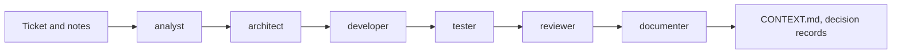

# Zejnilovic's agentic defaults

<p class="lead">Sensible defaults for agentic coding: test-first, reasonable coverage, and context that stays current. Generic instructions, skills and agents for <strong>Claude Code</strong> and <strong>GitHub Copilot</strong>, built for practical delivery on modest model budgets.</p>

[Quick start](start.md){ .md-button .md-button--primary } [Choose your path](paths.md){ .md-button } [Read the method](https://zejnilovic.eu/guides/working-with-coding-agents){ .md-button } [GitHub](https://github.com/Zejnilovic/agentic-defaults){ .md-button }

## Install it in two commands

=== "Homebrew"

    ```bash
    brew install zejnilovic/tap/agd
    ```

=== "Install script"

    ```bash
    curl -fsSL https://raw.githubusercontent.com/Zejnilovic/agd/main/install.sh | bash
    ```

Then, in your project's root:

```bash
agd init
```

[agd](https://zejnilovic.github.io/agd) is the installer: it copies the kit into your project and updates it later. Its own documentation covers everything else it does. Don't want a tool? [Copy the files by hand](paths.md#copy-by-hand).

## What you get

<div class="grid cards" markdown>

-   :material-file-document-outline:{ .lg .middle } **A working agreement**

    ---

    One short `AGENTS.md`, loaded into every conversation: deliver small, test first, start from written context, work economically, and a clear definition of done.

    [:octicons-arrow-right-24: Overview](inside.md)

-   :material-account-group-outline:{ .lg .middle } **Agents: who does the work**

    ---

    Thirteen roles, from analyst and architect to developers, tester, reviewers and documenter. Cheap models read and execute; strong models think.

    [:octicons-arrow-right-24: Agents](agents.md)

-   :material-book-open-variant:{ .lg .middle } **Skills: how it's done**

    ---

    Practices that load only when a task needs them: TDD, debugging, task plans, diagrams, project scans, and Flask, Spring, React and SQL.

    [:octicons-arrow-right-24: Skills](skills.md)

-   :material-file-tree-outline:{ .lg .middle } **Context that stays current**

    ---

    `CONTEXT.md` files describe your system for agents, and every task ends with a check that keeps them true to the code.

    [:octicons-arrow-right-24: Keep CONTEXT.md current](context.md)

-   :material-puzzle-outline:{ .lg .middle } **Only what you use**

    ---

    Install in packs: a core, plus research and the Flask, Spring, React and database developers your project needs.

    [:octicons-arrow-right-24: Packs](packs.md)

-   :material-swap-horizontal:{ .lg .middle } **Claude Code and Copilot**

    ---

    Plain Markdown, shell scripts and JSON in formats both tools read. Tools that read `AGENTS.md`, such as Cursor, get the working agreement.

    [:octicons-arrow-right-24: How they differ](tools.md)

</div>

## How a task flows

Small changes need nothing special: just chat, and the working agreement applies. Bigger ones go through roles, each handing its result back to you:



[:octicons-arrow-right-24: How work flows](workflow.md)

## Why it works this way

!!! quote "The method: Working with coding agents"
    The kit is one way to put a method into practice. [Working with coding agents](https://zejnilovic.eu/guides/working-with-coding-agents) explains it: the principles, rules of thumb, anti-patterns and nine hands-on exercises. It's written to stay true as tools and models change. The short version: **writing code is cheap now; knowing what is correct is not.**

    [:octicons-arrow-right-24: Read the method](https://zejnilovic.eu/guides/working-with-coding-agents)
