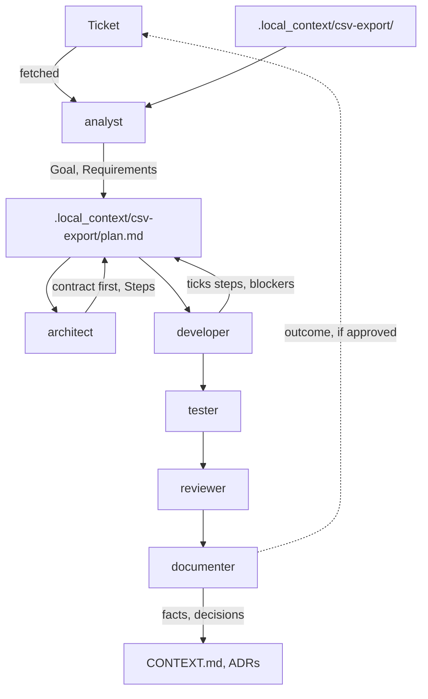

# How work flows

## Once per project

Have the analyst scan it:

> Use the analyst to scan this project.

That produces the root `CONTEXT.md` (purpose, stack, structure, contracts, a diagram) and the [standard commands](project.md#standard-commands) in `AGENTS.md`. Every later task starts from there.

## Per task

Small changes need none of this: the working agreement and skills cover a normal chat. For bigger ones, give the ticket number or put your notes in `.local_context/<task>/`, and go through the roles, skipping any the task doesn't need.

1. **Analyst** fetches the ticket, reads your notes and the code, and writes the plan's Goal, Context, Requirements and Open questions.
2. **Researcher**, only when the design depends on outside facts such as a library choice or an API. The **research collector** can gather the sources first, on an everyday model.
3. **Architect** answers the open questions, designs the approach and writes the Steps. When the work crosses a boundary, step 1 changes only the contract.
4. **Developers** implement one or a few steps at a time, each finished with the context check. Each step names its agent, in the order contract, database, backend, frontend.
5. **Tester** fills the gaps in coverage.
6. **Reviewer** checks the result against the plan. Add the **security reviewer** when the change touches authentication, permissions, untrusted input, secrets, cryptography or dependencies; the reviewer tells you when.
7. **Documenter** moves what lasts into `CONTEXT.md` and decision records, drafts an outcome for the ticket, and deletes the plan.

!!! example "What you type for a step"
    > relational-database-developer: implement step 2 of `.local_context/csv-export/plan.md`.

**When a step hits a wall**, the developer records it as a blocker in the plan and stops. The architect or you decide how to continue.

**To hand a task to someone else** mid-way, ask the documenter to draft a ticket update from the plan.

## Keeping model costs down

-   **Cheap models read, strong models think**

    ---

    The analyst and the research collector digest notes, code and sources on an everyday model; the architect and the researcher read only their short summaries.

-   **Orchestration is cheap**

    ---

    The main conversation only routes steps to agents and collects their reports, so it can run on an everyday model.

-   **Think once, execute many times**

    ---

    The architect writes steps concrete enough for an everyday model to carry out one at a time.

-   **The plan file is the handoff**

    ---

    Agents get a path and step numbers instead of a pasted plan, and a fresh session picks up where the last one stopped.

-   **Short output**

    ---

    Agents report the result first, one line per item, so their reports don't bloat the conversation that reads them.

-   **Scripts do the mechanical part**

    ---

    The survey script does most of a project scan in one command, instead of dozens of searches.

Prompts throughout the kit are written for everyday models: numbered steps, an explicit output format, and clear points where the agent stops and reports instead of trying again.
